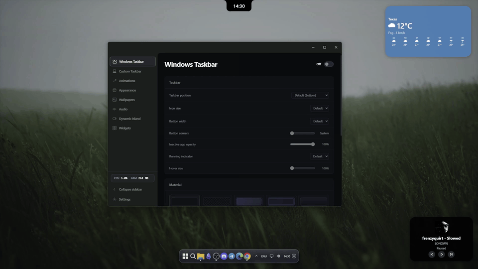
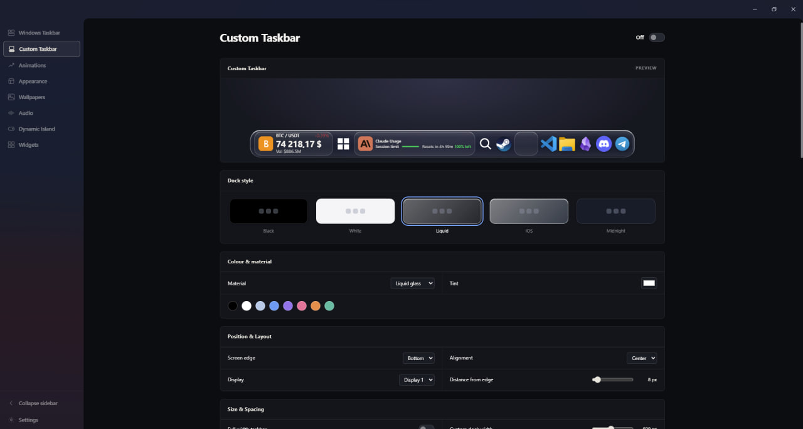
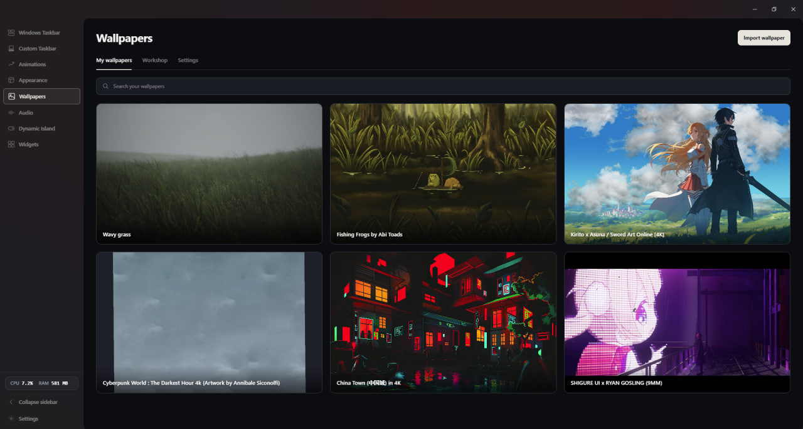
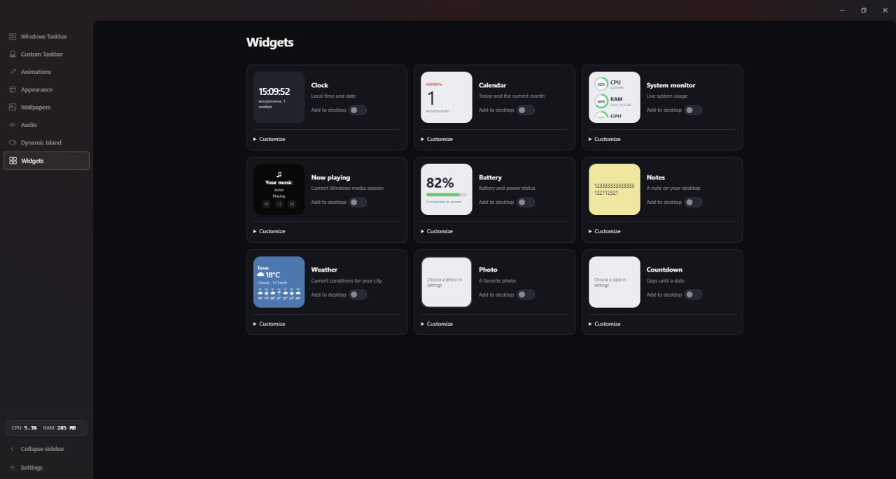
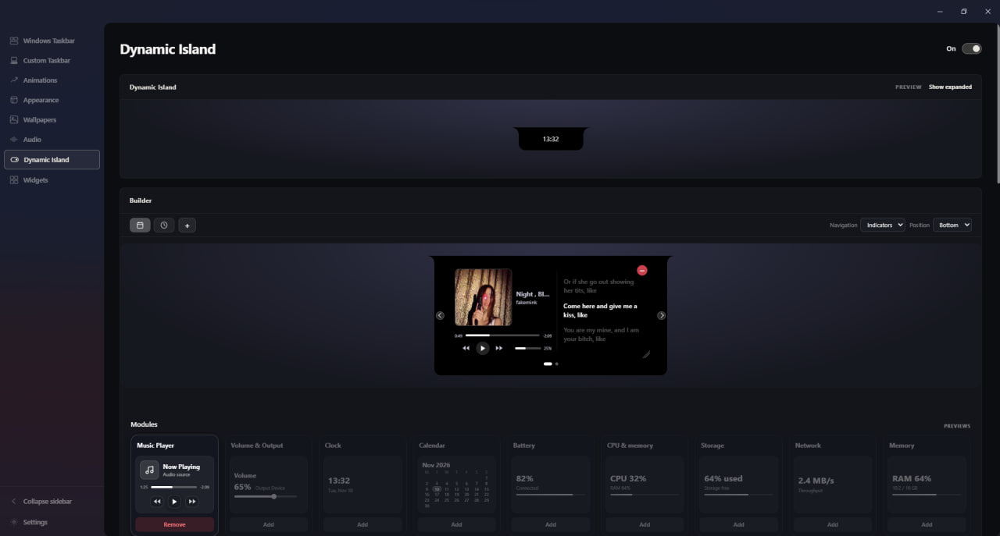
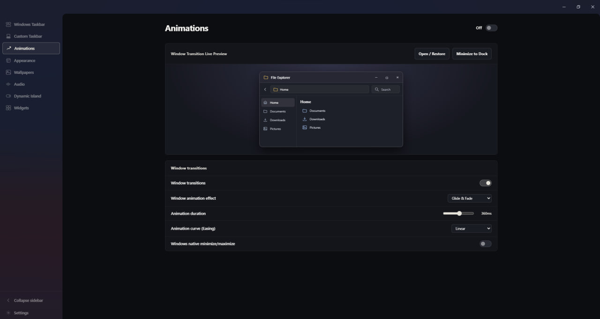
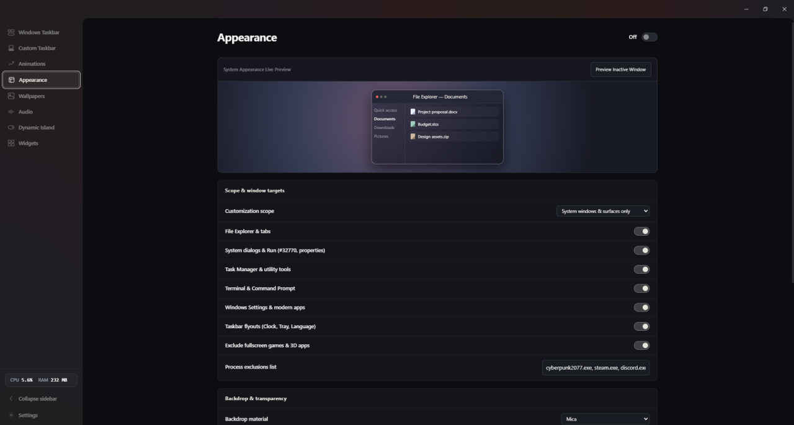
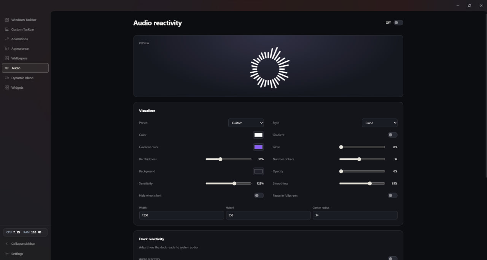
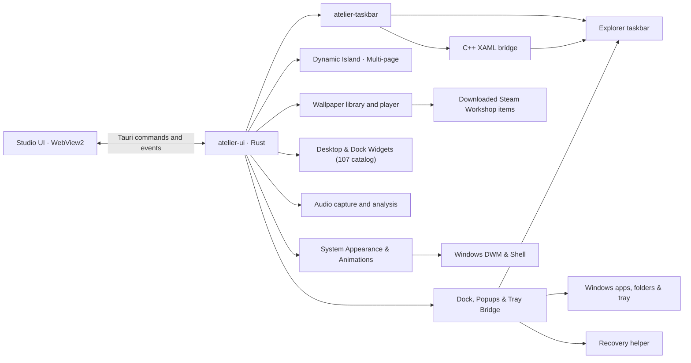

# Atelier

[](https://www.rust-lang.org/)
[](https://v2.tauri.app/)
[](docs/COMPATIBILITY.md)
[](docs/crates/TASKBAR.md)
[](docs/crates/UI.md)
[](docs/crates/TASKBAR.md)
[](docs/crates/WALLPAPER.md)
[](docs/crates/AUDIO.md)
[](#license)
[](CODE_OF_CONDUCT.md)

[](#features)
[](docs/DOCK.md)
[](docs/SYSTEM_APPEARANCE.md)
[](docs/SYSTEM_ANIMATIONS.md)
[](docs/DYNAMIC_ISLAND.md)
[](docs/WIDGET_INTEGRATIONS.md)
[](docs/crates/UI.md)
[](docs/SCENE_PLAYBACK.md)
[](docs/AUDIO_REACTIVITY.md)
[](#resource-efficiency-and-performance)
[](docs/FAILURES_AND_RECOVERY.md)

**Atelier** is an all-in-one desktop customization suite for Windows 10 and 11 built with Rust and Tauri v2. Through its Studio, Atelier styles the native Windows taskbar or provides a standalone Custom Taskbar dock, tailors system surface materials with Mica and Acrylic backdrops, and adds fluid physics-based window animations. It features an interactive Dynamic Island, live video and 2D scene wallpapers, audio-reactive visualizers, and customizable desktop widgets all engineered with zero-allocation telemetry and automatic memory trimming for near-zero idle CPU and RAM usage.

<p align="center">
  
</p>

<p align="center">
  <a href="https://github.com/polichdev/Atelier/releases/latest/download/Atelier-Setup.exe">
    <picture>
      <source media="(prefers-color-scheme: dark)" srcset="assets/download-button.svg">
      <source media="(prefers-color-scheme: light)" srcset="assets/download-button-light.svg">
      
    </picture>
  </a>
  <br>
  <a href="https://github.com/polichdev/Atelier/releases">
    
  </a>
</p>

## Features

- **Windows Taskbar:** configure materials, floating geometry and presets. On supported Windows 11 XAML taskbars, adjust app button and icon appearance.
- **Custom Taskbar:** a standalone desktop dock for pinned shortcuts, running windows, app folders (`dock-folder.html`), and embedded compact widgets (`dock-capsule`), with style presets (Black, White, Liquid Glass, iOS, Midnight), WinRT host-backdrop glass, full-width or centered geometry, pointer drag-and-drop reordering, auto-hide, and an AppBar gap below maximized windows. Includes a C++20 tray bridge (`atelier_tray_bridge.dll`) for the hidden tray icons popup (`tray.html`), a custom Atelier tray context menu (`atelier-menu.html`), an input language switcher, and a native audio output switcher (`audio-output-panel.html`). See [Desktop dock](docs/DOCK.md).

  <p align="center">
    
  </p>

- **Recovery:** the dock uses a helper process before hiding Explorer windows; native taskbar positioning has a separate guardian. See [Failure Modes & Recovery](docs/FAILURES_AND_RECOVERY.md).
- **Wallpapers:** import MP4/WebM files, apply and manage them in a local library, and configure playback and scene quality. The Workshop tab discovers Wallpaper Engine items already downloaded by Steam; browse the Workshop, subscribe in Steam, refresh, then import a supported video or 2D scene. Atelier does not download Workshop items directly. See [Wallpapers and Workshop](docs/WALLPAPERS.md).

  <p align="center">
    
  </p>

- **Scenes:** play supported 2D Wallpaper Engine scenes with per-wallpaper and author-provided controls. Compatibility is partial: custom shaders, SceneScript, 3D models and some effects and animations are not supported. See [Scene playback](docs/SCENE_PLAYBACK.md).
- **Widgets:** 107 catalog entries across 8 categories (AI quotas, Productivity, Dev Life, Revenue & SaaS, Crypto & Stocks, System & Stats, Quick Controls, and Media & Feeds) supporting both movable desktop overlays and embedded dock capsules, with native integrations for timers/stopwatch persistence, clipboard history, screen time, Docker stats, Codex CLI quotas, isolated billing page snapshots, ICAL.js calendar feeds, and direct audio output switching. See [Widget integrations](docs/WIDGET_INTEGRATIONS.md).

  <p align="center">
    
  </p>

- **Dynamic Island:** an optional top-of-screen capsule (`rounded`, `pill`, `square`, or `notch`) configured with an interactive visual grid designer (`100×100` freeform layout with collision detection) supporting up to 6 tabbed pages, synchronized `lrclib.net` lyrics, media & volume controls, built-in monthly calendar grid, weather, notes, countdown, battery, and hardware telemetry, with fullscreen/maximized window hiding and audio-reactive glow. See [Dynamic Island](docs/DYNAMIC_ISLAND.md).

  <p align="center">
    
  </p>

- **Animations:** customize window opening, minimizing, and restoring transitions with Scale, Genie, Glide, and Spring physics, alongside dock icon launch bouncing, hover wave magnification, and click feedback — complete with an interactive File Explorer preview in Studio.

  <p align="center">
    
  </p>

- **System Appearance:** customize surface materials and transparency across Windows system surfaces (File Explorer, Dialogs, Tools, Terminal, Flyouts, and Settings) with Mica, Mica Alt, Acrylic, and Glass backdrops, active and inactive window opacity, rounded/square corner preferences, and custom window borders, previewed live on Studio's interactive File Explorer stage.

  <p align="center">
    
  </p>

- **Audio reactivity:** add a movable desktop visualizer with bars, wave, dots, circle or a symmetric wave. Customize its colors, glow, transparent background, size, sensitivity and smoothing; it responds to the default system output. Optional pulse and glow effects can also be enabled per wallpaper, and the desktop dock can react with glow and shape changes. See [Audio reactivity](docs/AUDIO_REACTIVITY.md).

  <p align="center">
    
  </p>

## Architecture



The Tauri application is the primary Studio entry point. The separate `atelier-core` binary has its own tray and initialization path and is not the Tauri IPC backend. Details: [Architecture](docs/ARCHITECTURE.md).

## Resource Efficiency and Performance

Atelier is engineered to run continuously in the background with a minimal footprint:
- **Low Idle CPU (< 0.5%)**: Employs an event-driven design, avoiding continuous polling loops and waking up only on foreground window changes or user interaction. WASAPI audio loopback capture automatically idles when reactive visualizers are inactive or occluded.
- **Zero-Allocation NT Process Sampling**: Queries process metrics using `NtQuerySystemInformation` (`SystemProcessInformation`) directly with a reusable static memory buffer, completely avoiding runtime heap allocation churn.
- **Automatic Working Set Trimming**: Periodically purges unreferenced physical pages via `EmptyWorkingSet` across the main process and child WebView2 runtimes, keeping active Private Working Set RAM between ~100 MB and 160 MB.

## Documentation

### Guides and architecture

- [Documentation index](docs/README.md)
- [System Appearance](docs/SYSTEM_APPEARANCE.md)
- [System Animations & Window Transitions](docs/SYSTEM_ANIMATIONS.md)
- [Desktop dock](docs/DOCK.md)
- [Dynamic Island](docs/DYNAMIC_ISLAND.md)
- [Widget integrations](docs/WIDGET_INTEGRATIONS.md)
- [Wallpapers and Workshop](docs/WALLPAPERS.md)
- [Wallpaper preset catalog](docs/WALLPAPER_CATALOG.md)
- [Audio reactivity](docs/AUDIO_REACTIVITY.md)
- [Architecture and data flow](docs/ARCHITECTURE.md)
- [Repository structure](docs/STRUCTURE.md)
- [Configuration and storage](docs/CONFIGURATION.md)
- [Compatibility](docs/COMPATIBILITY.md)
- [Failure modes and recovery](docs/FAILURES_AND_RECOVERY.md)
- [Development and testing](docs/DEVELOPMENT.md)
- [Scene playback and compatibility](docs/SCENE_PLAYBACK.md)
- [Security considerations](docs/SECURITY.md)
- [Contributing](CONTRIBUTING.md) · [Code of Conduct](CODE_OF_CONDUCT.md) · [Changelog](CHANGELOG.md)

### Crate references

The names below match the directories in `crates/`. Cargo package names retain the `atelier-` prefix.

- [`common`](docs/crates/COMMON.md) — configuration, presets and errors.
- [`core`](docs/crates/CORE.md) — experimental daemon and tray.
- [`taskbar`](docs/crates/TASKBAR.md) — Explorer styling, positioning and recovery.
- [`ui`](docs/crates/UI.md) — Studio, wallpaper and widget controls, and the separate dock.
- [`wallpaper`](docs/crates/WALLPAPER.md) — desktop hosting, wallpaper formats and rendering infrastructure.
- [`audio`](docs/crates/AUDIO.md) — audio capture and spectrum analysis.
- [`widget`](docs/crates/WIDGET.md) — widget windows and data providers.

## Build and run

Prerequisites: Windows 10/11, a stable Rust MSVC toolchain, Visual C++ Build Tools with a Windows SDK, and WebView2 Runtime. The XAML bridge is compiled from C++ during the Cargo build. See [Compatibility](docs/COMPATIBILITY.md) for Windows-specific limitations.

```powershell
cargo check --workspace
cargo run -p atelier-ui --bin Atelier
```

For a development copy that does not lock `target\debug\Atelier.exe`, run `scripts\run-dev.cmd`. It stops matching Atelier development processes before rebuilding; see [Development](docs/DEVELOPMENT.md).

## Tests

```powershell
cargo test -p atelier-common
cargo test -p atelier-audio --lib
cargo test -p atelier-widget --lib
cargo test -p atelier-ui --lib
cargo test -p atelier-wallpaper --lib
node --test crates/ui/tests/*.test.cjs
node --test scripts/tests/*.test.cjs
cargo check --workspace
```

The repository also contains an isolated dock smoke test and Playwright UI tests. Some taskbar integration tests interact with the real Explorer taskbar; read [Development and testing](docs/DEVELOPMENT.md) before running them.

## License

Atelier is licensed under the [Apache License 2.0](LICENSE).
