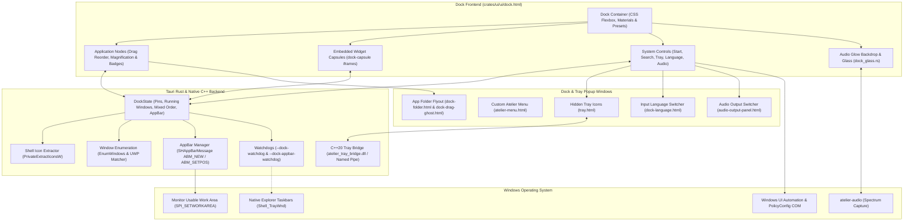
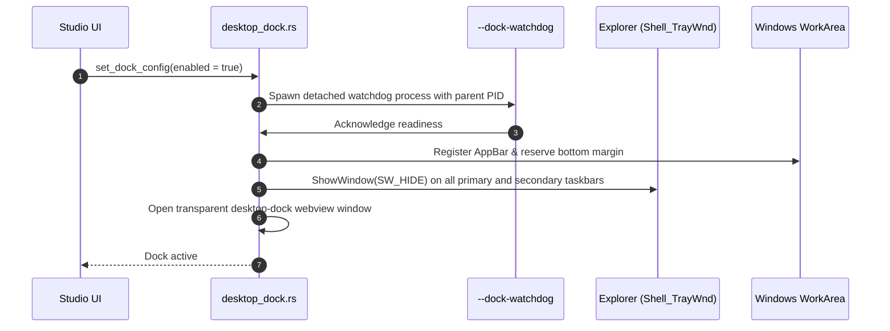
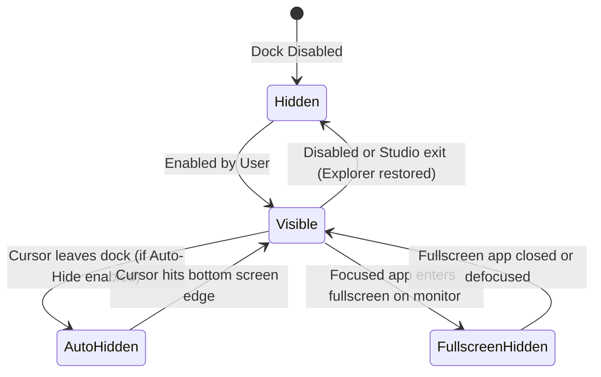

# Desktop Dock

The **Custom Taskbar** tab in Studio controls Atelier's standalone floating desktop dock. Enabling it seamlessly replaces the native Windows taskbar with an interactive, animated dock.

---

## Architectural Highlights

### 1. Dock Activation & Taskbar Hiding Handshake
To prevent accidental desktop lockouts if the application crashes during startup, the dock executes a verified handshake before hiding Explorer taskbars:

If the parent process crashes or is terminated from Task Manager, `--dock-watchdog` detects process death via `WaitForSingleObject` and restores `Shell_TrayWnd` to `SW_SHOW` immediately.

---

### 2. Dock Window States & Visibility

- **Fullscreen Detection**: The dock tracks foreground window rects using `GetWindowRect` and `MonitorFromWindow`. When an active full-screen game or video is detected on the dock's display, the dock hides itself and suspends all audio reactivity to eliminate GPU and CPU overhead.

---

### 3. Application Matching & Icon Resolution
- **Win32 Applications**: Extracted directly using `PrivateExtractIconsW` at high resolutions (64x64 or 128x128 PNG).
- **UWP / Windows Store Apps**: Modern packaged apps run inside `ApplicationFrameHost.exe`. The dock resolves the underlying CoreWindow app user model ID (AUMID) to correctly display the app's real icon rather than generic host icons.
- **Steam Shortcuts**: Maps Steam game launchers (`steam://rungameid/<id>`) to the running game executable so running badges attach directly to pinned Steam games.

---

### 4. System Controls, Native Tray Bridge & Popups

| System Button / Popup | Windows API / Subsystem | Behavior |
| :--- | :--- | :--- |
| **Start** | `keybd_event(VK_LWIN)` | Opens the native Windows Start Menu. |
| **Search** | `keybd_event(VK_LWIN + 'S')` | Opens Windows Search overlay. |
| **Network** | Shell Notification invocation | Opens the Windows 11 Quick Settings flyout. |
| **Volume / Audio Outputs** | `widget_audio_outputs.rs` (`PolicyConfig` COM) | Opens the custom [`audio-output-panel.html`](../crates/ui/ui/audio-output-panel.html) popup to switch active render/communications devices directly. |
| **Clock / Calendar** | `keybd_event(VK_LWIN + 'N')` | Opens the Notification Center and Monthly Calendar. |
| **Input Language** | `dock_languages` / `dock_select_language` | Opens [`dock-language.html`](../crates/ui/ui/dock-language.html) to view and switch active Windows input layouts. |
| **Hidden Tray Icons** | `atelier_tray_bridge.dll` (`tray_bridge.rs`) | Captures Shell_NotifyIcon updates over a local-only named pipe (`\\.\pipe\atelier_systray_monitor`) and renders third-party tray icons inside [`tray.html`](../crates/ui/ui/tray.html), forwarding left/right clicks cleanly. |
| **Atelier Context Menu** | `tray_panel.rs` (`atelier-menu.html`) | Right-clicking the Atelier tray icon opens a custom dark HTML menu displaying live CPU/RAM usage, quick theme presets, reset, and quit actions. |

---

### 5. Materials, Embedded Widgets, Folders & Drag Reordering
- **Style Presets & Native Glass (`dock_glass.rs`)**: Supports **Black**, **White**, **Liquid Glass**, **iOS**, and **Midnight** presets, full-width or custom-width layouts (`full_width`, `dock_width`), and WinRT Composition host-backdrop glass (`DWMWA_USE_HOSTBACKDROPBRUSH` + `CreateHostBackdropBrush`) with rounded geometry clipping.
- **Embedded Dock Widgets**: Compact `widget.html` capsules (`dock_widget_set`, `dock_widgets_reorder`) can live directly inside the dock alongside pinned apps and system controls.
- **App Folders & Drag Ghost (`dock-folder.html`, `folder_ghost.rs`)**: Apps can be grouped into folder capsules that open a styled popup flyout, with pointer drag-and-drop reordering across mixed dock items (`dock_reorder`) and a translucent drag preview window (`dock-drag-ghost.html`).

---

### 6. Workarea Reservation (AppBar Gap)
When maximized windows are open, they normally expand across the entire monitor workarea. Atelier provides a **Space below maximized apps** slider (plus an `auto_adjust_workarea` calculation):
- Registers a temporary system Application Desktop Toolbar (`SHAppBarMessage` with `ABM_NEW`).
- Updates `ABM_SETPOS` to set the exact bottom reservation height.
- Maximized applications respect this reserved boundary without overlapping the dock.
- Setting the slider to `0` deregisters the AppBar.
