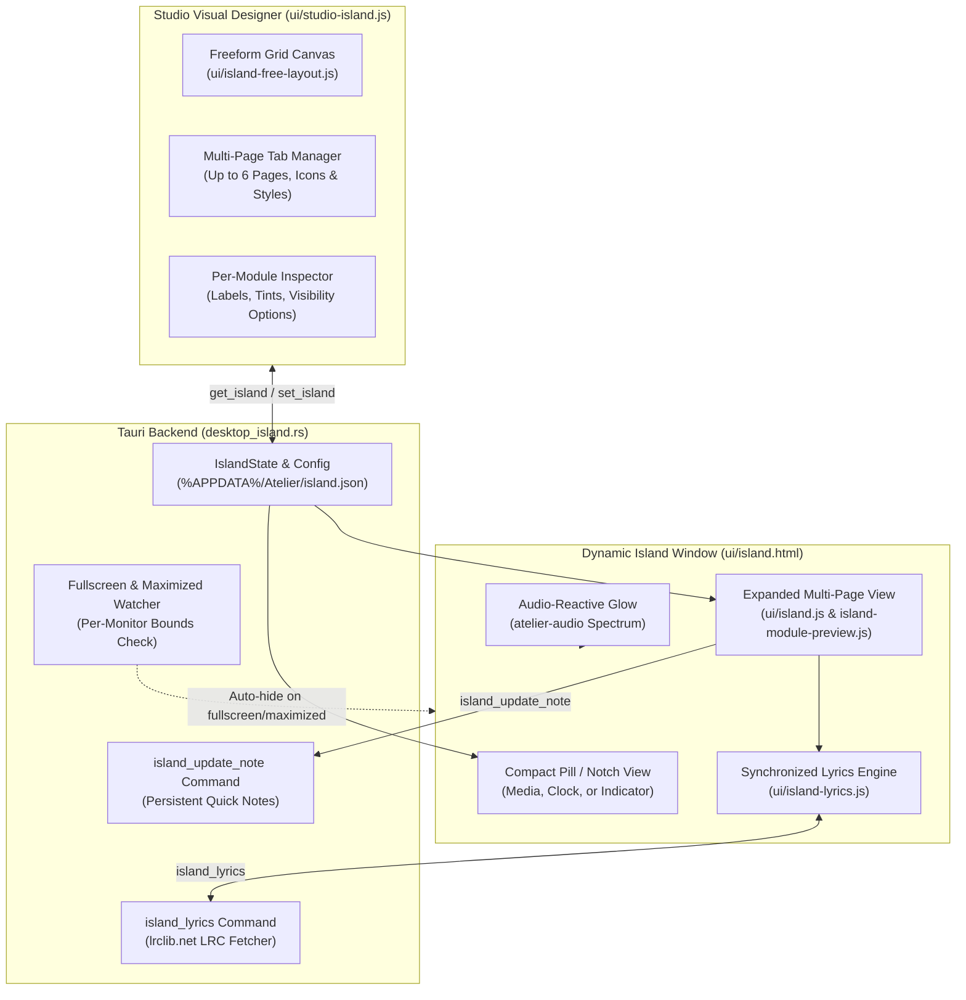
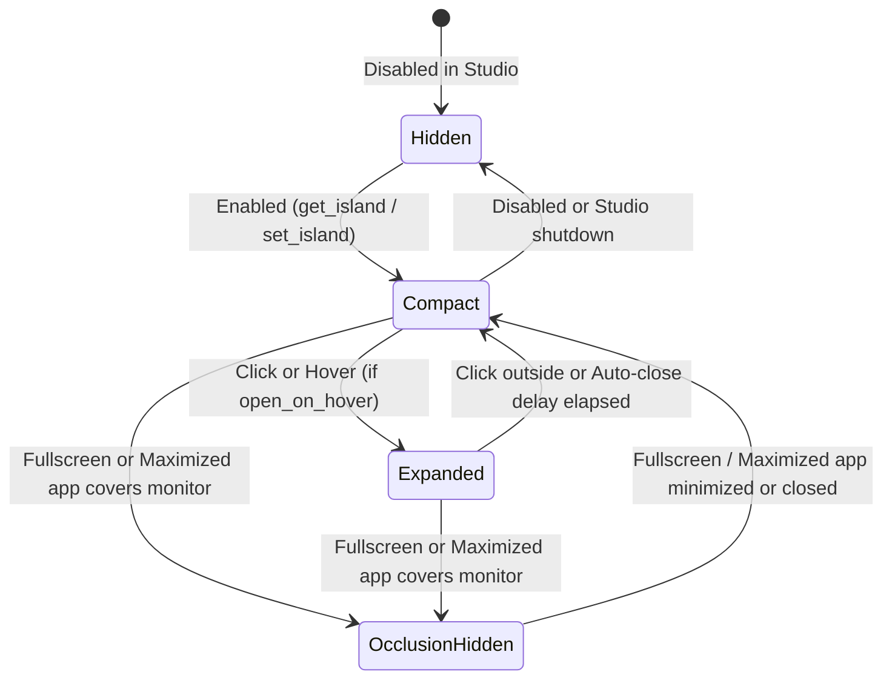

# Dynamic Island

Directory: [`crates/ui/src/desktop_island.rs`](../crates/ui/src/desktop_island.rs) · Configuration: `%APPDATA%\Atelier\island.json`

The **Dynamic Island** is an optional, top-of-screen interactive capsule hosted in its own transparent WebView2 window (`dynamic-island` / [`island.html`](../crates/ui/ui/island.html)). It remains compact during idle playback or status monitoring and smoothly expands on click or hover into a multi-page module workspace designed visually inside Studio.



---

## Window Lifecycle and Interaction States

The Dynamic Island monitors cursor hover, click expansion, auto-close timers, and foreground window bounds on the configured target monitor:



---

## Visual Designer & Freeform Grid Layout

Inside the **Dynamic Island** Studio tab (`crates/ui/ui/studio-island.js`), users configure the expanded layout visually without writing JSON:

- **100×100 Percentage Grid (`island-free-layout.js`)**: Modules are placed and resized on a normalized `100 × 100` coordinate space (`x`, `y`, `w`, `h`).
- **Per-Module Bounds & Collision Detection**: `IslandFreeLayout` enforces minimum and maximum footprint limits per module kind and prevents overlapping placements while allowing adjacent modules to touch.
- **Multi-Page Support**: Up to **6 pages** (`pages` array in `IslandConfig`), each with its own name, optional vector icon, button style (`default`, `outline`, `filled`), and independent module layout.
- **Navigation Styles**: Choose `buttons`, `dots` (with prev/next arrows), or `none` (single page), positioned at the `top`, `bottom`, `left`, or `right` of the expanded panel.

---

## Supported Modules

| Module | Key Capabilities |
| :--- | :--- |
| **Music Player (`media`)** | Live SMTC track metadata, album artwork (`small`, `medium`, `large` layouts), playback controls, seek scrubber, inline volume slider, and synchronized LRC lyrics (`lrclib.net`). |
| **Volume & Output (`audio`)** | Master system volume slider and mute toggle. |
| **Clock (`clock`) & Date (`date`)** | 24-hour digital clock and localized date display. |
| **Calendar (`calendar`)** | Built-in Monday-first monthly calendar grid (`island-calendar.js`) highlighting the current day. |
| **Battery (`battery`)** | Charge percentage and AC/charging indicator. |
| **System & Hardware** | `system` (CPU & memory), `memory`, `gpu`, `disk` (storage), `network`, `uptime`, and `cpu_frequency`. |
| **Weather (`weather`)** | Current conditions and temperature via Open-Meteo with configurable city and °C/°F unit toggle. |
| **Note (`note`)** | Editable quick memo persisted directly back to `island.json` via `island_update_note`. |
| **Countdown (`countdown`)** | Days remaining until a configured target date and title. |

---

## Shapes, Appearance & Audio Reactivity

- **Panel Shapes**: Supports `rounded`, `pill`, `square`, and `notch` (top-edge display cutout with CSS shoulder curves defined in `island-shape.css`).
- **Compact Mode**: Independently configurable compact width, compact height, alignment (`left`, `center`, `right`), compact content (`music`, `clock`, etc.), and status indicator position.
- **Audio Reactivity**: Optional `audio_reactive` edge glow reacting to system output energy with customizable `audio_color` and `audio_strength`.

---

## Configuration Schema

Stored at `%APPDATA%\Atelier\island.json` (excerpt of core fields):

```json
{
  "enabled": false,
  "monitor": 0,
  "width": 520,
  "compact_width": 230,
  "compact_height": 46,
  "expanded_height": 220,
  "shape": "rounded",
  "radius": 24,
  "opacity": 96,
  "color": "#08090c",
  "open_on_hover": false,
  "auto_close": true,
  "close_delay": 700,
  "hide_fullscreen": true,
  "hide_maximized": true,
  "tab_style": "buttons",
  "tab_position": "top",
  "audio_reactive": false,
  "pages": [
    {
      "id": "page-1",
      "name": "Home",
      "style": "default",
      "layout": []
    }
  ]
}
```
