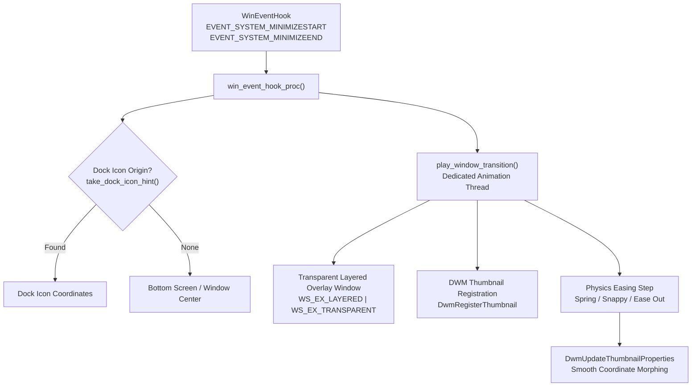

# System Animations & Window Transitions

Directory: [`crates/ui/src/system_animations.rs`](../crates/ui/src/system_animations.rs) · Configuration: `%APPDATA%\Atelier\animations.json`

The **System Animations** engine brings fluid, physics-based transitions to Windows application windows and desktop interactions. It intercepts minimize, restore, and launch actions across the desktop shell to deliver smooth, modern visual feedback.



---

## Window Minimize & Restore Transitions

### 1. Interception Mechanism
Atelier registers a non-intrusive out-of-context Win32 accessibility event hook via `SetWinEventHook`:
- `EVENT_SYSTEM_MINIMIZESTART (0x0016)`: Triggers when a window begins minimizing.
- `EVENT_SYSTEM_MINIMIZEEND (0x0017)`: Triggers when a minimized window is restored or brought to the foreground.

Windows animation debouncing ensures rapid repeated clicks do not cause double-animation artifacts or race conditions.

### 2. Live Window Morphing via DWM Thumbnails
Rather than taking static screenshots or resizing heavy top-level window frames:
1. Atelier creates a lightweight, click-through topmost layered window covering the transition bounds.
2. Registers a live visual thumbnail of the target HWND via `DwmRegisterThumbnail`.
3. In a 60 FPS animation loop, interpolates the thumbnail rectangle coordinates (`DWM_TNP_RECTDESTINATION`) and opacity (`DWM_TNP_OPACITY`).
4. At completion, unregisters the thumbnail (`DwmUnregisterThumbnail`) and dismantles the transition overlay without interfering with the underlying application state.

---

## Physics & Easing Functions

Atelier provides customizable physics curves to match user preference:

| Easing Style | Formula / Behavior | Feel |
| :--- | :--- | :--- |
| **Spring** | Damped harmonic oscillator: `1.0 - exp(-6t) * cos(2π * 1.15t)` | Organic bounce and dynamic recoil |
| **Snappy** | Quadratic deceleration curve: `t * (2.0 - t)` | Fast, responsive, and sharp |
| **Ease Out** | Cubic bezier curve: `1.0 - (1.0 - t)^3` | Smooth and elegant deceleration |
| **Linear** | Constant velocity interpolation: `t` | Uniform mechanical progression |

### Transition Effects
- **Dock Expand / Zoom from Icon**: Windows expand outwards directly from their specific application icon on the taskbar/dock and collapse back into the icon upon minimizing.
- **Scale**: Centered geometric scaling with alpha fade.
- **Genie**: Fluid bottom-anchored taper transition.
- **Glide**: Upward/downward vertical slide with motion blur effect.
- **Fade & Pop**: Rapid opacity fade accompanied by subtle magnification pulse.

---

## Dock Interaction Animations

Complementing window transitions, the Desktop Dock features rich interactive animations configured in the Animations tab:

- **Launch Bouncing**:
  - `always`: App icon bounces every time it is activated.
  - `launch_only`: App icon bounces only when starting a new application instance.
  - `notification`: Bounces when the app requests user attention.
  - `off`: Disables icon bouncing.
  - `dock_bounce_count`: Configurable repeats (1 to 5 bounces).
- **Hover Wave Magnification**:
  - Parabolic sinusoidal magnification wave enlarging adjacent icons as the pointer glides across the dock.
  - Configurable scale factor (`dock_hover_scale`: 100% to 180%).
- **Click Feedback**:
  - `bounce`: Playful vertical hop.
  - `press`: Subtle tactile compression.
  - `pulse`: Radial glow pulse.
  - `none`: Instantaneous activation without animation.

---

## Configuration Schema

Stored at `%APPDATA%\Atelier\animations.json`:

```json
{
  "enabled": true,
  "window_transitions": true,
  "window_effect": "dock_expand",
  "window_duration": 240,
  "window_easing": "spring",
  "native_min_max_animation": false,
  "dock_bounce": "launch_only",
  "dock_bounce_count": 2,
  "dock_hover_wave": true,
  "dock_hover_scale": 135,
  "dock_click_feedback": "bounce"
}
```
