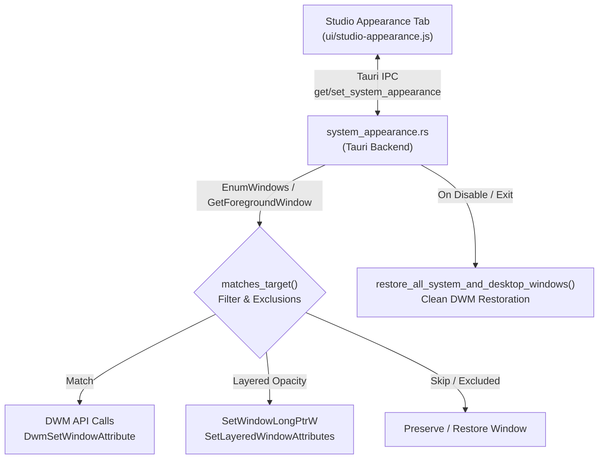

# System Appearance

Directory: [`crates/ui/src/system_appearance.rs`](../crates/ui/src/system_appearance.rs) · Configuration: `%APPDATA%\Atelier\appearance.json`

Atelier's **System Appearance** subsystem provides deep, non-destructive customization of Windows system window backdrops, corner geometry, borders, titlebar themes, and window transparency. It operates directly at the Desktop Window Manager (DWM) level using native Win32 and DWM APIs, with zero DLL injection or kernel hooks.



---

## Capabilities and Features

### 1. DWM System Backdrops
Customizes the background composition material of supported system surfaces:
- **Default**: Windows standard background rendering.
- **Mica**: Subtle dynamic tinting sampling the desktop wallpaper.
- **Mica Alt**: High-contrast variant with prominent wallpaper material sampling.
- **Acrylic**: Translucent blurred backdrop with noise texture.
- **Glass**: Semi-transparent Aero-style glass aesthetic.

### 2. Window Corners & Geometry
Direct control over `DWMWA_WINDOW_CORNER_PREFERENCE`:
- **Default**: OS default corner rounding.
- **Rounded**: Full rounded corners (standard Windows 11 style).
- **Small Rounded**: Compact rounding for subtle geometry.
- **Square**: Sharp 90-degree corners (classic Windows 10 style).

### 3. Window Borders & Accent Colors
- **Border Width & State**: Borderless or custom width styling.
- **Border Color**: Accepts `"default"` or any custom hex color (`#RRGGBB`), mapped to Win32 `COLORREF` and applied via `DWMWA_BORDER_COLOR`.

### 4. Titlebar & Immersive Dark Mode
- **System**: Follows the active Windows theme.
- **Dark**: Forces immersive dark titlebar across target windows via `DWMWA_USE_IMMERSIVE_DARK_MODE`.
- **Light**: Forces clean light titlebar styling.
- **Custom**: Applies custom accent color to window caption area via `DWMWA_CAPTION_COLOR`.

### 5. Transparency & Layered Opacity
- **Active Window Opacity**: Configurable from 50% to 100%.
- **Inactive Window Opacity**: Configurable independently from 50% to 100% to emphasize the active focus window.
- **Layered Style Management**: Dynamically sets `WS_EX_LAYERED` and `SetLayeredWindowAttributes` with alpha transparency, tracking original styles to ensure only Atelier-modified layered attributes are restored upon exit.
- **Interactive Studio Preview**: Studio embeds a live interactive File Explorer demo window (`studio-window-preview.js`) allowing instant preview of backdrop materials, opacity (active/inactive toggle), corner rounding, and border styling before applying changes system-wide.

---

## Granular Target Surfaces

Atelier allows targeting system surfaces selectively, avoiding interference with regular third-party productivity apps:

| Surface Category | Filter Rules & Window Classes |
| :--- | :--- |
| **File Explorer & Tabs** | `CabinetWClass`, `ExploreWClass`, `ShellTabWindowClass`, `XamlExplorerHostIslandWindow` |
| **System Dialogs** | `#32770`, `OperationStatusWindow`, `ProgressDialog`, Run dialog (`Выполнить` / `Run`), File Properties |
| **System Tools** | `TaskManagerWindow` (`taskmgr.exe`), `Notepad` / `RichEditD2DPT` (`notepad.exe`) |
| **Terminal & Consoles** | `ConsoleWindowClass`, `CASCADIA_HOSTING_WINDOW_CLASS`, `cmd.exe`, `powershell.exe`, `windowsterminal.exe` |
| **Windows Settings** | `SystemSettings.exe`, `ApplicationFrameWindow` matching settings patterns |
| **System Flyouts** | `TopLevelWindowForOverflowXamlIsland`, `NotifyIconOverflowWindow`, `ControlCenterWindow`, `ClockFlyoutWindow`, `InputSwitchWindow`, Shell Tray flyouts |

### Scopes & Exclusions
- **System Surfaces Only (`system_only`)**: Targets exclusively the system categories selected above.
- **All Windows (`all_windows`)**: Expands to all top-level application windows with captions, while respecting the exclusion list.
- **Excluded Applications**: Customizable executable blacklist (e.g. `steam.exe`, `discord.exe`).
- **Fullscreen & 3D Games**: Automatically detects exclusive fullscreen or direct 3D windows (`Valve001`, `UnrealWindow`, `UnityWndClass`) to prevent overlay conflicts and preserve gaming performance.

---

## Configuration Schema

Stored at `%APPDATA%\Atelier\appearance.json`:

```json
{
  "enabled": true,
  "scope": "system_only",
  "backdrop": "mica",
  "opacity": 94,
  "inactive_opacity": 82,
  "corner_preference": "rounded",
  "border_color": "default",
  "border_width": 1,
  "titlebar_mode": "dark",
  "titlebar_color": "default",
  "target_explorer": true,
  "target_dialogs": true,
  "target_tools": true,
  "target_terminal": true,
  "target_settings": true,
  "target_flyouts": true,
  "excluded_apps": ["cyberpunk2077.exe", "steam.exe", "discord.exe"],
  "exclude_fullscreen_games": true
}
```

---

## Clean Restoration & Safety

When System Appearance is disabled in Studio or when Atelier terminates:
1. `restore_all_system_and_desktop_windows()` enumerates every tracked HWND in memory.
2. DWM attributes (corners, borders, captions, backdrops) are reset to their default unmanaged states.
3. If `WS_EX_LAYERED` was added by Atelier, it is removed and window alpha is restored to 255.
4. `SetWindowPos(SWP_FRAMECHANGED)` and `RedrawWindow` force DWM to immediately re-compose the restored window.
