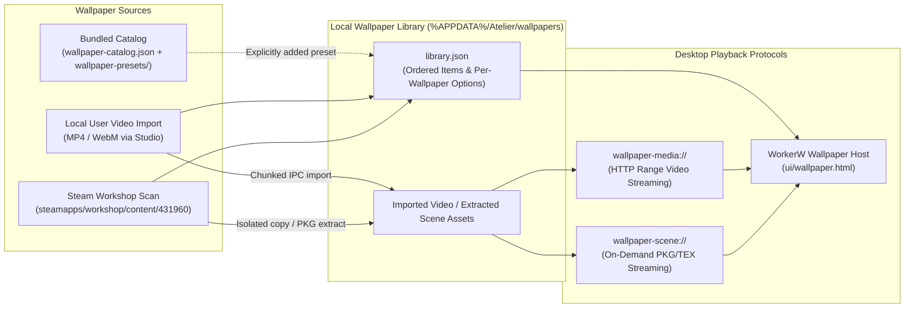

# Wallpaper preset catalog

The bundled catalog is [`crates/ui/ui/wallpaper-catalog.json`](../crates/ui/ui/wallpaper-catalog.json). Each entry has a unique `preset-` ID, title, category, kind and description. The player retains support for procedural and bundled video presets. The current Studio library displays imported videos and scenes; adding a catalog entry alone does not make it visible in the gallery.

## Bundling vs. Importing

- **Bundled Presets**: To bundle a video preset, put an MP4 or WebM in `crates/ui/ui/wallpaper-presets/` and add a catalog entry with kind `preset-video` and an `asset` field containing only its lowercase filename, for example `night-sky.mp4`. Files in this folder are shipped with the application. Catalog and asset changes are shipped with an application update; there is no remote catalog or server download.
- **User Video Imports**: Users can import MP4 and WebM videos into their local library. Imported files remain on the device in `%APPDATA%\Atelier\wallpapers\` and are not published to the preset catalog.
- **Steam Workshop Imports**: Workshop scenes and videos discovered on disk are copied/extracted into the local library so they remain playable offline.
