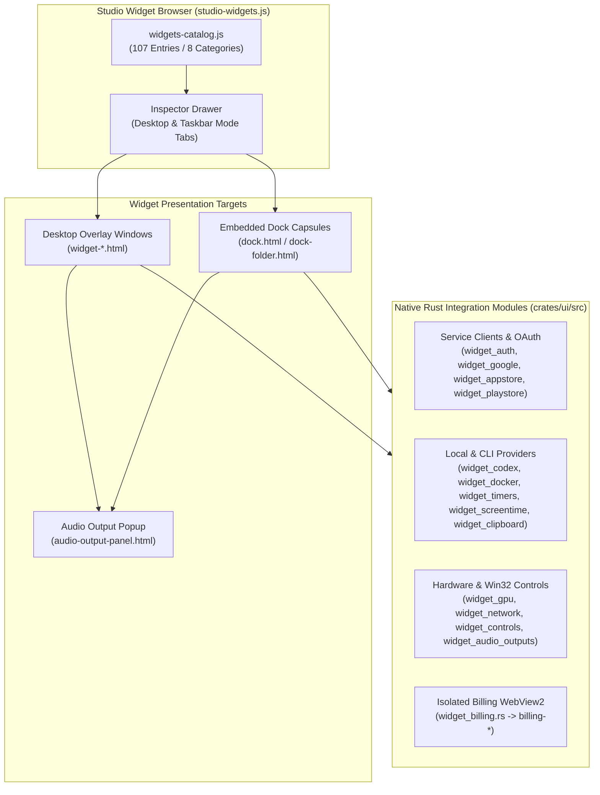
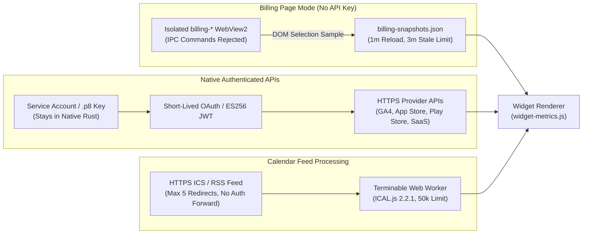

# Widget integration status

Updated: 2026-11-08. The catalog contains 107 entries across 8 categories (backed by 109 registered kinds in `desktop_widgets.rs`, including desktop, dock capsule, and utility widgets). Data paths now exist for every card, including service connections, local state and native Windows functions. The supported metrics and remaining service/hardware limits are specified below.

Automated tests exercise local logic and mocked service responses. They do not establish successful access to a real customer account or visual correctness in the running application.

---

## Integration & Security Data Paths

---

## Implemented integrations added in this work

- Billing page connections: OpenAI and Anthropic prepaid cards can read a user-selected USD credit amount after sign-in in a dedicated WebView2 window. No API key is used in this mode. A native cache stores the selected element, amount and timestamp; the browser reloads every minute and readings older than three minutes are marked stale. Disconnect clears the isolated browser data and stops monitoring. This is a page reading, not a documented balance API; login support and page changes depend on the provider, and selecting the correct credit figure is required.
- Stripe MRR has an additional Billing page source: sign in and select the USD MRR figure on Stripe Billing to reflect the dashboard's own definitions, discounts and tiers. The API estimate remains available separately.
- Perplexity account credits: explicitly supplied session-token value and cookie name, fixed-origin native GET, credit-field validation and expiry/HTTP errors. This reads reported account credits and usage, not daily Pro search counters. The endpoint is undocumented and was checked against the maintained CodexBar client implementation, not a published Perplexity API contract.
- Paddle: official Metrics API MRR, annualized MRR, net revenue before refunds/chargebacks and checkout conversion, using completed UTC-day ranges. Conversion uses aggregate completed/total checkout counts, not an average of daily percentages.
- Dodo: complete paginated payment-record reports for the UTC day/month, successful gross amounts per currency and payment-record success rate. Gross amounts are before refunds. These ratios are not checkout conversion.
- Shopify: paginated non-test orders created in the local day/month, net received payments, average current order value excluding canceled orders, and the exact UNFULFILLED status count. Decimal money aggregation and average rounding use integers. Payment/refund totals refer to these orders, not every payment/refund transaction occurring in the period.
- Docker: complete container list within explicit response/10,000-record limits, sampled CPU and memory, per-container view and five-second native caching. Timeouts and unavailable statistics remain errors instead of fabricated zero usage.
- Audio Switcher: active Windows output enumeration, direct default output switching with readback, optional communications-role switching and rollback on failure. Windows Sound Settings remains available as a fallback.
- Calendars: bundled ICAL.js 2.2.1 handles RRULE/RDATE/EXDATE, revised, moved, canceled and THISANDFUTURE instances, floating/all-day times, embedded VTIMEZONE and IANA/DST conversion. Parsing runs in a terminable worker, with 50,000 occurrence and size/time limits. Public RSS/ICS fetching now follows up to five HTTPS redirects without authorization headers.
- ChatGPT: reads the Codex quota bucket through the installed Codex CLI app-server and account/rateLimits/read. Requires an existing ChatGPT sign-in in Codex. Uses reported window durations, percentages and reset timestamps; does not create a thread or inference turn. CLI path is configurable; request timeout is 20 seconds and successful data is cached for 60 seconds.
- GLM: personal Coding Plan quota meters from the first-party Z.ai/BigModel monitor endpoint. Uses reported percentages only; unknown meter types are skipped and missing percentages are errors. Pay-as-you-go balance is not implemented.
- OpenAI and Anthropic cards now offer API spend using organization Admin credentials and official cost reports, with complete pagination and UTC day/month periods. These are explicitly spend measurements, not prepaid balances. Anthropic Analytics reports can lag up to 24 hours.
- Timer, Pomodoro and Stopwatch: shared native state now checkpoints to timers.json every five seconds while running and on actions. State and up to 100 stopwatch laps survive restart; elapsed wall-clock time while Atelier was closed is applied to running timers. Desktop shows scrollable lap history; taskbar keeps compact controls and the latest-lap tooltip. System clock changes while Atelier is closed can affect restored running intervals.
- App Store sales: local ES256 signing with a .p8 key path, vendor number and report date; gzip TSV parsing, net report units and per-currency proceeds with exact decimal aggregation. Counts include report product types, not only app downloads.
- Google Play: service-account JSON key path, read-only OAuth exchange and the monthly country install report from the account report bucket. Shows latest reported daily installs and active devices. Reports are delayed by Google; no crash metric is implemented.
- S&P 500 and NASDAQ-100: FMP index quotes for ^GSPC and ^NDX, requiring index quote entitlement.
- Cursor: Team Admin API request activity today in UTC, cached hourly. Personal Pro account credits are not implemented.
- Copilot: organization 28-day signed report downloads, displaying the newest daily activity. Requires organization metrics permission; personal quota is not implemented.
- OpenCode: explicitly configured local server port, session and API version; measured tokens from the newest assistant message. Only the default server username opencode is supported.
- GA4 realtime: service-account JSON key path with Analytics Viewer access and a numeric property ID, or a manually supplied OAuth access token. The service-account mode obtains a fresh short-lived token automatically; its private key and access token stay in native code. Returns active users and page/screen views in the last 30 minutes. Browser OAuth sign-in and refresh of manually supplied access tokens are not implemented.
- Gold and silver: Twelve Data XAU/USD and XAG/USD quotes. Requires an API key and instrument entitlement. Quotes are cached for five minutes.

## Account setup required

- Prepaid balances: select Prepaid balance, Connect Billing page, sign in and select the USD credit amount. No successful real-account sign-in has been verified in this work. Providers may require interactive authentication; challenges are not automated.
- Stripe dashboard MRR: select Billing page as the data source, sign in and select the MRR amount. Other currencies currently require the API source.
- Perplexity: provide the session-token value in widget settings, select its cookie name and verify the returned credit data. A pplx API key is not a web-session credential. A real authenticated response has not been tested.
- API-backed cards require their own account credentials, scopes and product entitlements. Successful model-list access is not proof of billing or quota access.

## Material limitations of implemented entries

- ai_claude, ai_claude_plan and ai_gemini depend on quota buckets actually returned by an Antigravity connection. They do not synthesize missing buckets.
- ai_grok is an xAI API prepaid balance widget, requiring a management key and team ID. SuperGrok subscription usage is not implemented.
- Stripe MRR's API source is an estimate for licensed, per-unit monthly/yearly subscriptions. Discounts, item trials and tiered prices require the Billing page source to read the dashboard amount.
- Stripe Net includes charge, refund and partial-capture-reversal reporting categories and their transaction fees. It excludes payouts and unrelated balance movements.
- Paddle's optional active-subscription count mode uses the API's estimated count; annualized MRR is the newest reported MRR multiplied by twelve.
- Direct audio output switching uses the Windows PolicyConfig COM interface; its availability depends on the Windows version. No live device change was performed during validation.
- GPU fan and memory sensors currently require NVIDIA NVML; other vendors and motherboard/CPU fan sensors are not implemented.
- Calendar processing has explicit size, occurrence and worker-time limits; feeds that exceed them fail rather than return partial calendars.

## Primary references for the latest implementations

- [OpenAI Docs: Codex app-server account API](https://learn.chatgpt.com/docs/app-server)
- [OpenAI Docs: organization Costs API](https://developers.openai.com/api/reference/resources/admin/subresources/organization/subresources/usage/methods/costs)
- [Z.ai usage plugin](https://docs.z.ai/devpack/extension/usage-query-plugin) and its [first-party request implementation](https://github.com/zai-org/zai-coding-plugins/blob/main/plugins/glm-plan-usage/skills/usage-query-skill/scripts/query-usage.mjs)
- [Anthropic Usage and Cost Analytics API](https://platform.claude.com/docs/en/manage-claude/usage-cost-analytics-api)
- [Google Analytics authentication](https://developers.google.com/analytics/devguides/reporting/data/v1/quickstart) and [service-account token exchange](https://developers.google.com/identity/protocols/oauth2/service-account)
- [Paddle Metrics API](https://developer.paddle.com/api-reference/metrics/) and [MRR](https://developer.paddle.com/api-reference/metrics/get-metrics-monthly-recurring-revenue)
- [Dodo first-party payment SDK](https://github.com/dodopayments/dodopayments-typescript/blob/main/src/resources/payments.ts)
- [Shopify Order money fields](https://shopify.dev/docs/api/admin-graphql/2026-10/objects/Order)
- [Docker stats](https://docs.docker.com/reference/cli/docker/container/stats/)
- [ICAL.js source and license](https://github.com/kewisch/ical.js), bundled notices in crates/ui/ui/vendor
- [Perplexity client integration source](https://github.com/steipete/CodexBar/blob/main/Sources/CodexBarCore/Resources/Plugins/perplexity.js)
