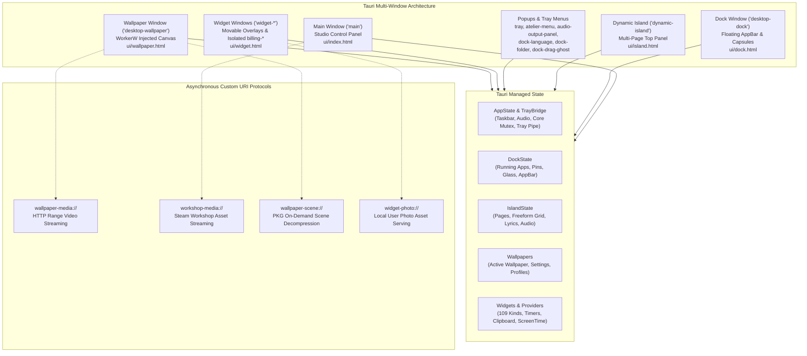
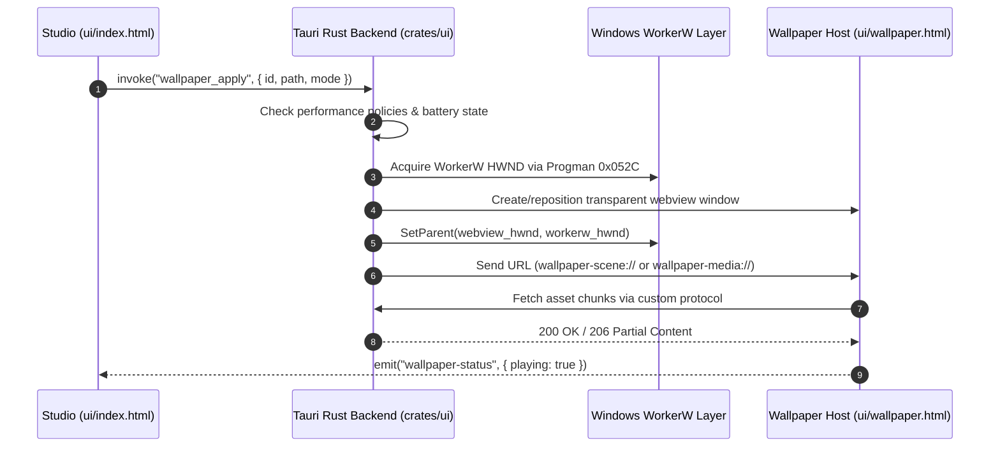

# atelier-ui

Directory: [`crates/ui`](../../crates/ui/) · Cargo package: `atelier-ui`

`atelier-ui` is the primary interactive user-facing application for **Atelier**, built on the **Tauri 2.0** framework and Microsoft WebView2. It hosts the Studio control panel, the floating desktop dock, customizable desktop overlay widgets, and the background live wallpaper runtime window.



---

## Architectural Highlights

### 1. Multi-Window Lifecycle & Window Management
- **Mica Studio Shell**: The main configuration window utilizes Windows 11 Mica backdrop composition with dark mode styling, providing access to Taskbar, Custom Taskbar, Animations, Appearance, Wallpapers, Audio, Dynamic Island, Widgets, and General settings.
- **Desktop Dock & Popups**: Operates as a transparent, layered, frameless window (`dock.html`) with WinRT Composition host-backdrop glass (`dock_glass.rs`), app folder flyouts (`dock-folder.html`), drag ghosts (`dock-drag-ghost.html`), input language switcher (`dock-language.html`), audio output switcher (`audio-output-panel.html`), hidden tray popup (`tray.html`), and custom Atelier context menu (`atelier-menu.html`).
- **Dynamic Island**: A multi-page top-of-screen capsule (`island.html`) with freeform grid layout, synchronized lyrics (`lrclib.net`), and occlusion hiding.
- **Desktop Widgets**: Enabled desktop widgets run in lightweight WebView windows (`widget-*`) or as embedded `.dock-capsule` iframes inside the dock; billing page captures use isolated `billing-*` windows with IPC commands rejected.
- **Desktop Wallpaper Window**: Injected directly behind the desktop icons into the Windows `WorkerW` layer (between `SHELLDLL_DefView` and the desktop background).



---

## Key Backend Modules

| Module | Source File | Description |
| :--- | :--- | :--- |
| **System Appearance** | [`src/system_appearance.rs`](../../crates/ui/src/system_appearance.rs) | DWM window backdrop materials (Mica, Mica Alt, Acrylic, Glass), active/inactive opacity, corner preference, titlebar mode, and granular system surface filters. |
| **System Animations** | [`src/system_animations.rs`](../../crates/ui/src/system_animations.rs) | WinEvent hooks (`EVENT_SYSTEM_MINIMIZESTART/END`), live DWM thumbnail transitions, spring physics easing curves, and dock-origin zoom animations. |
| **App Usage & Memory** | [`src/app_usage.rs`](../../crates/ui/src/app_usage.rs) | Zero-allocation NT query sampling (`WorkingSetPrivateSize` and CPU %), automatic background `EmptyWorkingSet` memory trimming, and studio sidebar telemetry. |
| **Desktop Dock & Glass** | [`src/desktop_dock.rs`](../../crates/ui/src/desktop_dock.rs), [`src/dock_glass.rs`](../../crates/ui/src/dock_glass.rs), [`src/folder_ghost.rs`](../../crates/ui/src/folder_ghost.rs) | Taskbar enumeration, Explorer icon extraction, UWP matching, pinned shortcuts, AppBar reservation, WinRT host-backdrop glass, embedded widget capsules, and folder drag ghosts. |
| **Tray Bridge & Panels** | [`src/tray_bridge.rs`](../../crates/ui/src/tray_bridge.rs), [`src/tray_panel.rs`](../../crates/ui/src/tray_panel.rs), [`src/tray_protocol.rs`](../../crates/ui/src/tray_protocol.rs) | C++20 `atelier_tray_bridge.dll` named-pipe server capturing hidden tray icons, plus custom HTML `tray-panel` and `atelier-menu` context popup windows. |
| **Dynamic Island** | [`src/desktop_island.rs`](../../crates/ui/src/desktop_island.rs) | Multi-page Dynamic Island state (`island.json`), `lrclib.net` synchronized lyrics lookup, persistent quick notes, and fullscreen/maximized occlusion hiding. |
| **Desktop Wallpaper** | [`src/desktop_wallpaper.rs`](../../crates/ui/src/desktop_wallpaper.rs) | Live wallpaper lifecycle controller, profile persistence, audio reactivity options, and `wallpaper-media://` byte-range video streaming. |
| **Scene Engine Bridge** | [`src/wallpaper_scene.rs`](../../crates/ui/src/wallpaper_scene.rs) | Extraction of Wallpaper Engine `.pkg` archives, JSON project parsing, and `wallpaper-scene://` protocol asset server. |
| **Scene Geometry** | [`src/scene_geometry.rs`](../../crates/ui/src/scene_geometry.rs) | Scene layer transformations, parent-child hierarchies, 2D bone rigs, and mesh deformation resolution. |
| **Scene Effects** | [`src/scene_effects.rs`](../../crates/ui/src/scene_effects.rs) | Shader effect passes, uniform binding evaluation, author composite switches, and arithmetic expressions. |
| **Scene Preview** | [`src/scene_preview.rs`](../../crates/ui/src/scene_preview.rs) | Offscreen CPU/GPU thumbnail composition engine generating full-fidelity PNG previews of 2D scenes. |
| **Performance Watcher**| [`src/wallpaper_performance.rs`](../../crates/ui/src/wallpaper_performance.rs) | Real-time monitoring of fullscreen/maximized applications, battery status, process execution pause rules, and display frame rate caps. |
| **Steam Workshop** | [`src/steam_workshop.rs`](../../crates/ui/src/steam_workshop.rs) | Automatic detection of Steam install folders and Wallpaper Engine Workshop downloads (`workshop/content/431960`), VDF parsing, and safe importing. |
| **Desktop Widgets & Providers** | [`src/desktop_widgets.rs`](../../crates/ui/src/desktop_widgets.rs), `src/widget_*.rs` | 109 widget kinds, coordinate/size bounds, audio spectrum dispatch, and native integrations (`widget_auth`, `widget_billing`, `widget_codex`, `widget_docker`, `widget_audio_outputs`, `widget_timers`, `widget_screentime`, `widget_clipboard`, `widget_google`, `widget_appstore`, `widget_playstore`, `widget_gpu`, `widget_network`, `widget_controls`, `widget_metrics`, `widget_photo`, `widget_reminder`). |
| **Installer** | [`src/installer.rs`](../../crates/ui/src/installer.rs) | Self-installer / uninstaller mode (`--installer`, `--uninstall`) UI and shortcut creation. |
| **Desktop Background** | [`src/desktop_background.rs`](../../crates/ui/src/desktop_background.rs) | Safe backup and atomic restoration of the native Windows wallpaper when live wallpapers are toggled or on application exit. |

---

## Custom Protocol Handlers

`atelier-ui` registers four asynchronous URI scheme protocols to safely stream local assets to WebViews without triggering Chromium cross-origin or file-access security errors:

1. **`wallpaper-media://`**: Supports HTTP `Range: bytes=start-end` requests, allowing seamless hardware-accelerated video streaming and loop seeking for large MP4 and WebM videos.
2. **`wallpaper-scene://`**: Resolves local scene directories and `.pkg` archive contents on the fly, streaming unpacked images, models, and JSON definitions directly into the WebGL player.
3. **`workshop-media://`**: Provides sandboxed access to preview images and media files stored in Steam Workshop directories.
4. **`widget-photo://`**: Serves local GIF and image uploads for the desktop photo widget.

---

## Testing

```powershell
# Run Rust library unit tests for atelier-ui
cargo test -p atelier-ui --lib

# Run JavaScript frontend unit tests (81 tests)
node --test crates/ui/tests/*.test.cjs

# Run widget integration & dock layout test suites
node --test scripts/tests/*.test.cjs
```
