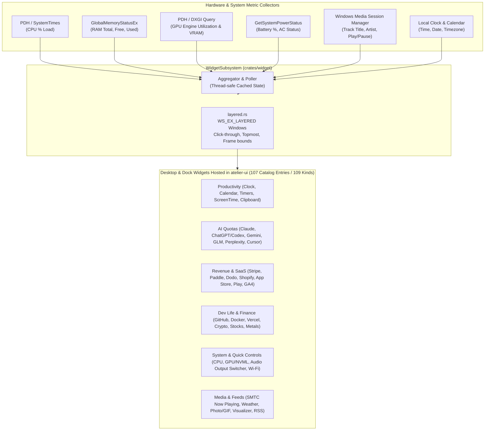
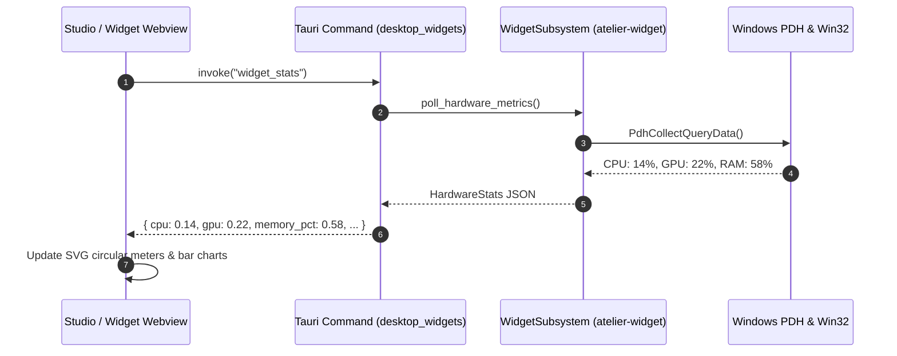

# atelier-widget

Directory: [`crates/widget`](../../crates/widget/) · Cargo package: `atelier-widget`

`atelier-widget` provides the system polling and native layered window infrastructure for **Atelier**'s desktop overlay widgets. It queries real-time Windows hardware performance metrics (CPU, RAM, GPU, VRAM, Battery), captures system media playback metadata via modern Windows Runtime APIs, and controls transparent desktop overlay windows.



---

## Architectural Highlights

### 1. Hardware Performance Metric Polling
- **CPU Load**: Collects accurate processor time across all cores using Windows Performance Data Helper (`PdhOpenQueryW`, `\Processor(_Total)\% Processor Time`) with automatic fallback to kernel `GetSystemTimes`.
- **GPU and VRAM**: Queries dedicated GPU engines and video memory budgets via DirectX Graphics Infrastructure (DXGI) and PDH performance counters (`\GPU Engine(*)\Utilization Percentage`).
- **Memory**: Samples virtual and physical RAM via `GlobalMemoryStatusEx`.
- **Battery**: Reads instantaneous battery percentages, charging states, and remaining operational time via `GetSystemPowerStatus`.



---

### 2. Media Transport Controls Integration
- Interfaces with the Windows `GlobalSystemMediaTransportControlsSessionManager` (SMTC) to display currently playing songs from Spotify, Apple Music, YouTube in web browsers, and media players, caching the session manager and extrapolating real-time playback position while playing.
- Exposes metadata (title, artist, album art, timeline position) and dispatches media controls (Play, Pause, Skip, Previous, Seek).

---

### 3. Layered Window Infrastructure (`layered.rs`)
- Constructs Win32 layered overlay windows (`WS_EX_LAYERED`, `WS_EX_TOOLWINDOW`, `WS_EX_NOACTIVATE`).
- Supports seamless switching between **interactive edit mode** (movable, resizable, visible borders) and **ambient desktop mode** (`WS_EX_TRANSPARENT`, allowing clicks to pass through directly to desktop icons).
- Preserves layout margins across multi-monitor setups and different DPI scaling factors (100%, 125%, 150%, 200%).

---

## Widget Catalog

In addition to the core desktop widgets (`clock`, `calendar`, `system`, `media`, `battery`, `notes`, `weather`, `photo`, `countdown`, `audio`), [`widgets-catalog.js`](../../crates/ui/ui/widgets-catalog.js) and [`desktop_widgets.rs`](../../crates/ui/src/desktop_widgets.rs) provide **107 catalog entries across 8 categories** (`ai`, `productivity`, `dev`, `revenue`, `finance`, `system`, `controls`, `utilities`) plus dock-specific utility kinds (`sys_tray`, `app_folder`), supporting both desktop overlays and embedded dock capsules.

For detailed API integrations, OAuth scopes, billing page isolation, and hardware limitations, see **[Widget Integrations](../WIDGET_INTEGRATIONS.md)**.

| Category | Representative Widgets | Backing Modules |
| :--- | :--- | :--- |
| **Productivity** | Clock, Calendar (ICAL.js), Focus Timers / Pomodoro / Stopwatch, Screen Time, Clipboard History, Notes | `widget_timers.rs`, `widget_screentime.rs`, `widget_clipboard.rs`, `widget-calendar-worker.js` |
| **AI** | Antigravity Claude/Gemini, ChatGPT (Codex CLI), GLM, Perplexity, Cursor, Copilot, OpenCode, OpenAI/Anthropic Spend & Prepaid | `widget_codex.rs`, `widget_auth.rs`, `widget_billing.rs` |
| **Revenue & SaaS** | Stripe MRR/Net/Today, Paddle, Dodo, Shopify, Polar, Lemon Squeezy, DataFast, GA4, App Store, Google Play | `widget_auth.rs`, `widget_billing.rs`, `widget_google.rs`, `widget_appstore.rs`, `widget_playstore.rs` |
| **Dev Life & Finance** | GitHub, GitLab CI, Docker Containers, Vercel, LeetCode, Crypto, S&P 500, NASDAQ-100, Gold/Silver | `widget_docker.rs`, `widget_auth.rs` |
| **System & Quick Controls** | CPU, RAM, GPU/VRAM (NVML), Thermals, Disk, Ping, Wi-Fi, Bluetooth, Volume, Brightness, Audio Output Switcher | `widget_gpu.rs`, `widget_metrics.rs`, `widget_network.rs`, `widget_controls.rs`, `widget_audio_outputs.rs` |
| **Media & Feeds** | SMTC Media Player, Weather (Open-Meteo), Photo/GIF, Audio Visualizer, Hacker News, RSS, NASA APOD | `media.rs`, `widget_photo.rs`, `widget_auth.rs` |

---

## Testing

```powershell
# Run unit tests for atelier-widget
cargo test -p atelier-widget
```
Unit tests validate widget bounding rectangles, coordinate normalization, DPI margin offsets, and GIF photo upload limits.
